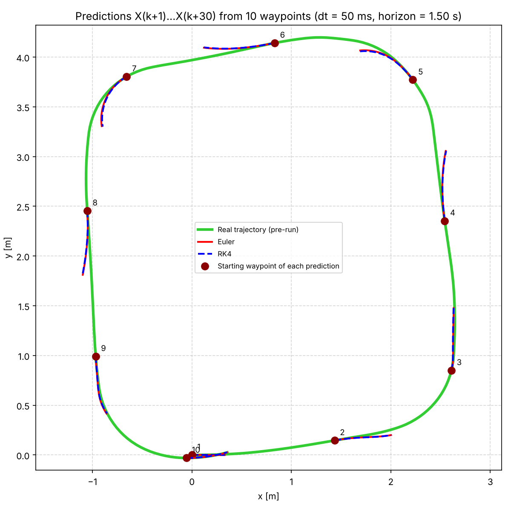
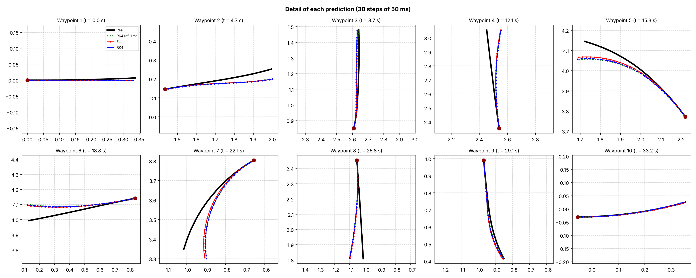
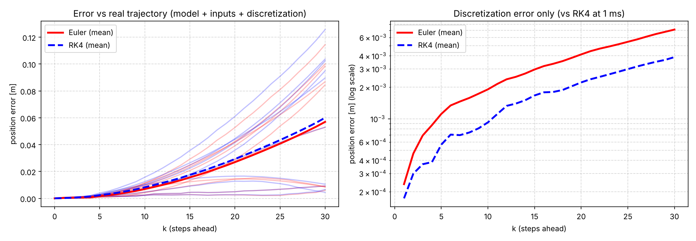

# QCar Trajectory Prediction — Euler vs. RK4

N-step state prediction for the Quanser **QCar** using a discretized **Ackermann (kinematic bicycle) model**. The model is integrated with **explicit Euler** and **4th-order Runge-Kutta (RK4)**, and both predictions are validated against a real trajectory recorded with ROS 2.

Developed for the Smart Mobility concentration (MR3004C) at Tecnológico de Monterrey, Campus Puebla.



---

## Overview

From 10 waypoints spread along a recorded lap, the script:

1. Takes the real pose `X(k) = [x, y, θ]` as the initial condition.
2. Predicts `X(k+1) … X(k+30)` (1.5 s horizon, 50 ms step) with Euler and with RK4.
3. Compares both predictions against:
   - the **real trajectory** (total error: model + inputs + discretization), and
   - a **fine-step RK4 reference** at 1 ms (discretization error only).

## Model

Kinematic bicycle model with state `z = [x, y, θ]` and inputs `u = [v, δ]`:

```
ẋ = v · cos(θ)
ẏ = v · sin(θ)
θ̇ = v · tan(δ) / L
```

| Parameter | Value | Description |
|---|---|---|
| `L` | 0.256 m | QCar wheelbase |
| `DT` | 50 ms | Discretization step |
| `DT_REF` | 1 ms | Reference step |
| `N_STEPS` | 30 | Prediction steps per waypoint |
| `N_WAYPOINTS` | 10 | Starting waypoints |
| `STEER_DELAY` | 2.2 s | Command-to-wheel delay (provisional calibration) |
| `STEER_GAIN` | 1.6 | `δ_real = gain · command` (provisional calibration) |

**Discretization**

- Euler: `z(k+1) = z(k) + Δt · f(z, u)`
- RK4: `z(k+1) = z(k) + Δt/6 · (k1 + 2k2 + 2k3 + k4)`

The model and both integrators are built symbolically with [CasADi](https://web.casadi.org/).

## Repository Structure

```
qcar-trajectory-prediction/
├── data/
│   ├── rosbag/qcar_bag_20261009_164244/
│   │   ├── metadata.yaml                     # ROS 2 bag metadata
│   │   └── qcar_bag_20261009_164244_0.mcap   # Recorded run (MCAP)
│   └── waypoints/
│       └── waypoints.csv                     # Reference path: x, y, yaw, v
├── results/                                  # Generated figures
├── src/
│   └── qcar_waypoint_prediction.py           # Main script
├── requirements.txt
└── README.md
```

## Data

**ROS 2 bag** (`ros_distro: jazzy`, MCAP, ~71 s, 14,057 messages):

| Topic | Type | Messages | Used for |
|---|---|---|---|
| `/qcar/velocity` | `geometry_msgs/Vector3Stamped` | 710 | Measured speed `v` |
| `/qcar/user_command` | `geometry_msgs/Vector3Stamped` | 6,907 | Steering command `δ` |
| `/qcar/imu` | `sensor_msgs/Imu` | 6,440 | Not used |

**Waypoints** (`waypoints.csv`): 263 poses of the pre-run lap with columns `x [m]`, `y [m]`, `yaw [rad]`, `v [m/s]`. Each waypoint is matched in time to the bag by arc length.

## Installation

Requires Python 3.9+.

```bash
git clone https://github.com/Gabrysaid29/qcar-trajectory-prediction.git
cd qcar-trajectory-prediction
pip install -r requirements.txt
```

## Usage

```bash
python src/qcar_waypoint_prediction.py
```

The figures are saved in `results/` and a summary is printed in the terminal. Parameters can be changed at the top of the script.

## Results

| Mean position error at k = 30 (1.5 s) | Euler | RK4 |
|---|---|---|
| vs. real trajectory | 0.057 m | 0.060 m |
| vs. 1 ms RK4 reference | 7.1 × 10⁻³ m | 3.9 × 10⁻³ m |

**Detail of each prediction**



**Error analysis**



**Key findings**

- Over a 1.5 s horizon, both integrators stay within ~6 cm of the real trajectory.
- RK4 roughly halves the **discretization** error compared with Euler.
- Against the real data both methods perform almost the same: the dominant error comes from the **model and the inputs** (steering calibration, delay, slip), not from the integrator.

## Limitations

- Steering gain and delay are provisional and were tuned by hand.
- The kinematic model ignores tire slip and vehicle dynamics.
- The real pose is reconstructed from waypoints, not from an external tracking system.

## Dependencies

`numpy`, `pandas`, `matplotlib`, `casadi`, `mcap`, `mcap-ros2-support`

## Author

**Gabriel Said Vera Carballo** — Mechatronics Engineering, Tecnológico de Monterrey, Campus Puebla
